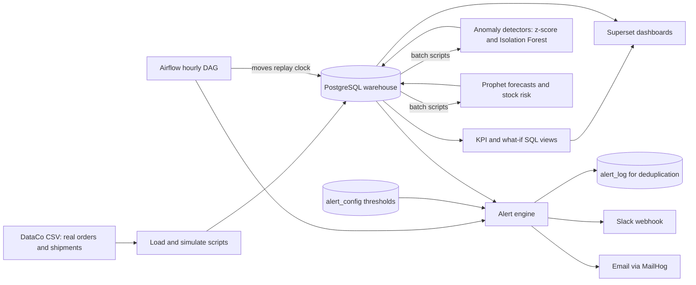

# Architecture

## Components

| Component | Role |
|---|---|
| PostgreSQL 15 | One server, three databases: `warehouse` (data), `airflow`, `superset` |
| Airflow 2.10 (LocalExecutor) | Hourly DAG: move the replay clock, check alert rules, send alerts |
| Python 3.11 package `control_tower` | Loading, simulation, detectors, forecasting, alerts. DAG tasks call it in a separate virtual environment inside the Airflow image, so its libraries cannot clash with Airflow's |
| Prophet | Demand forecasts for the best-selling products still selling at the replay clock |
| Isolation Forest and z-score | Two anomaly detectors, scored against labeled injected anomalies |
| Superset 4.1 | Three dashboards: KPIs, forecasts and anomalies, what-if |
| MailHog | Local mailbox that catches alert emails (no real mail account needed) |

## Data flow

1. **Real data:** DataCo orders and shipments (180,519 order lines, 2015-01-01 to 2018-01-31).
2. **Simulated data:** suppliers, supplier deliveries, daily inventory, injected demand spikes and supplier delays. The injected anomalies are recorded in `anomaly_labels`, which the detectors never read. It is used only to score them.
3. **Replay clock:** `replay_state.watermark_ts` starts at 2017-01-01 and moves forward one day per hourly run. Every KPI view and the alert engine only see data before the clock, so history behaves like a live feed.
4. **Alerts:** rules and thresholds live in `alert_config`. Each fired alert is written to `alert_log`, and the same rule and entity cannot alert again inside its cooldown (6 hours by default).